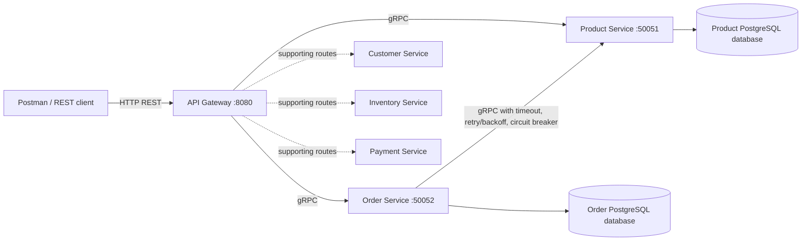

# Ecommerce Microservices (WEB303 Assignment 1)

## Overview

This Go project demonstrates an ecommerce domain through a REST API Gateway and gRPC services. The main assignment resources are **Products** and **Orders**. Orders depend on Products, so an order operation should validate the referenced product through the Product Service gRPC API rather than reading the Product Service database directly.

## Architecture



Postman requests should target the API Gateway only. Each primary service should read and write only its own database.

## Requirements

- Go services and Protocol Buffer (`.proto`) definitions.
- Product and Order CRUD exposed through gRPC.
- Separate database per primary service.
- Order Service calls Product Service through gRPC with timeout, retries with backoff, and a circuit breaker.
- REST Gateway maps gRPC errors to suitable HTTP status codes and validates requests.
- Multi-stage Dockerfiles and Docker Compose.

> Before submission, verify these requirements against the current source code and capture evidence for each one. A passing `go test ./...` does not by itself prove database isolation or all CRUD paths.

## Run with Docker Compose

From the repository root, with Docker Desktop running:

```bash
docker compose up --build
```

To run in the background instead:

```bash
docker compose up --build -d
```

Check containers:

```bash
docker compose ps
```

View logs:

```bash
docker compose logs --tail=100
```

Stop the stack:

```bash
docker compose down
```

If database volumes must also be reset (this permanently deletes local test data), use `docker compose down -v`.

## API Gateway examples

Base URL: `http://localhost:8080`

### Products

| Method | Path | Purpose |
|---|---|---|
| POST | `/api/products` | Create a product |
| GET | `/api/products` | List products |
| GET | `/api/products/{id}` | Retrieve a product |
| PUT | `/api/products/{id}` | Update a product |
| DELETE | `/api/products/{id}` | Delete a product |

Example product body:

```json
{
  "productId": "P501",
  "name": "Postman Test Keyboard",
  "price": 2500
}
```

### Orders

| Method | Path | Purpose |
|---|---|---|
| POST | `/api/orders` | Create an order |
| GET | `/api/orders` | List orders |
| GET | `/api/orders/{id}` | Retrieve an order |
| PUT | `/api/orders/{id}` | Update an order |
| DELETE | `/api/orders/{id}` | Delete an order |

Example order body:

```json
{
  "orderId": "ORD501",
  "productId": "P001",
  "quantity": 2
}
```

### Supporting routes already present in the project

- `GET /api/customers?id=C001`
- `GET /api/inventory?id=P001`
- `POST /api/payments` with JSON such as `{"orderId":"ORD501","amount":150000}`

These are supporting demo services; the assignment's core architecture and evidence should focus on the two collaborating Product and Order services.

## Tests

Run from the repository root:

```bash
go test ./...
```

## Postman collection

Import `ecommerce_microservices_postman_collection.json` into Postman. Set `baseUrl` to `http://localhost:8080` if needed. Run the CRUD requests in each folder in order (create, retrieve/list, update, delete). If a create request returns `409 Conflict`, change the `productId` or `orderId` collection variable to a new value and retry.

## Report evidence checklist

Capture screenshots from your actual running project and add a caption plus a short explanation for every image. Recommended evidence:

1. Docker Compose containers running and database health.
2. Product CRUD through the Gateway, including a successful create/retrieve/update/delete sequence.
3. Order CRUD through the Gateway.
4. Successful Order-to-Product gRPC dependency.
5. Validation rejection (for example, empty product name or invalid price).
6. gRPC-to-HTTP error mapping (for example, a missing product returns 404).
7. Resilience behaviour with Product Service unavailable, showing bounded timeout/retries and circuit-breaker response.
8. `go test ./...` output.
9. Postman collection imported and successful requests.

Only describe behaviour that you have actually verified in the source and through tests.
